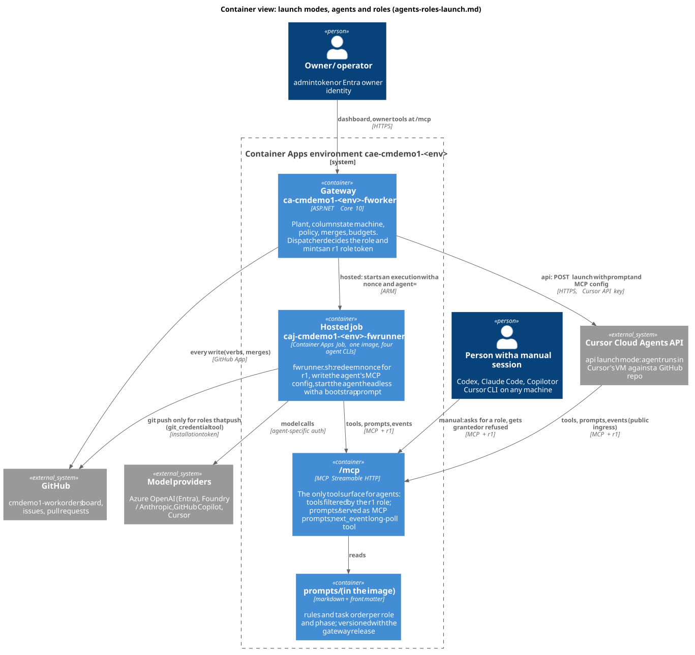

# Agents, roles and launch modes: one role token, prompts served live, MCP as the only tool surface

Status: approved 2026-10-16; steps 1 to 3, 4 (bootstrap and worker prompts) and 9 (api mode with Cursor Cloud Agents, off by default) built
2026-10-17 (section 17). The rest is design. A refactoring of how the factory starts AI sessions, tells them what to do and lets
them act, from the owner's decisions of 2026-10-16 (section 1). Builds on `cloud-worker-runtimes.md` (the `cae-job` runtime, w2, nonces,
`git-credential`), `environment-test-factories.md` (pull request 159, not merged on 2026-10-16: every role on demand, the owner tools at `/mcp`), `plant-manager.md`
(tokens, slots, guard rails 10e), `operator-session.md`, `backlog-keeper.md` and `worker-messaging.md` (the stream).

Diagrams (PlantUML sources and rendered SVG in `docs/design/diagrams/`):

| View | Source | Rendered |
|---|---|---|
| Container view: launch modes, agents, roles, `/mcp` | `arl-container.puml` | [arl-container.svg](diagrams/arl-container.svg) |
| Dynamic: one hosted session gets a role, its prompt and its tools | `arl-hosted-session.puml` | [arl-hosted-session.svg](diagrams/arl-hosted-session.svg) |



## 0. Summary

1. **Session = launch mode × agent × role × environment.** Launch modes `manual`, `hosted`, `api` replace the four session types and the
   separate `runtime` field. Agents within manual and hosted: `codex`, `claude`, `copilot`, `cursor`. In `api` v1 only Cursor Cloud Agents.
2. **The gateway decides the role at dispatch** and mints one **role token** (`r1`) for exactly that role, item and phase. Any session can
   play any role. The per-role kinds `w1`, `w2`, `m1`, `o1`, `k1` and the item token `i1` collapse into `r1` (the QC link `q1` and the runtime nonce `n1` stay as they are: they are not role credentials); the old kinds stay accepted
   during migration and are mapped to an equivalent role principal in one place.
3. **The gateway's `/mcp` is the only tool surface for agents.** Every agent-facing verb becomes an MCP tool; `tools/list` shows only the
   tools of the token's role, and every call is authorized again by the same `AuthorizeVerb` logic the verbs use today. The owner tools of
   `environment-test-factories.md` 18 are the `owner` role on the same server. `pwsh factory.ps1` and the plugin download are retired for
   agents (kept for the operator and the tests).
4. **Instructions are prompt files, served live.** `prompts/` holds one markdown file per role and phase, with front matter. The gateway
   serves them as MCP prompts; a session fetches its prompt at the start of every task, so a merged prompt change applies to the next task
   after the gateway release, with no image rebuild. Rules that protect anything stay in code; prompts are not a security control.
5. **Events over MCP by a long-poll tool** `next_event` (section 7): it works in every CLI, whatever its support for server notifications.
6. **One hosted image with all four CLIs** at pinned versions, the agent chosen per execution (section 9).

## 1. Owner decisions (2026-10-16, fixed)

1. Three launch modes replace session types: `manual` (a person starts it and connects it), `hosted` (a container the gateway starts: the
   Container Apps job), `api` (the gateway starts an external service's agent through its API; v1: Cursor Cloud Agents only).
2. In manual and hosted, four agent CLIs: Codex CLI, Claude Code CLI, GitHub Copilot CLI, Cursor CLI, each with an adapter (install,
   headless start, model auth, MCP config, prompt).
3. Any agent session can play any role; the gateway decides the role at dispatch and mints a token for exactly that role. The role
   determines the MCP tools listed, the GitHub credential scope (only roles that push get `git_credential`) and model limits. A manual session
   asks for a role; the gateway grants or refuses it by slot and policy. One role-scoped token format replaces the per-role kinds, with
   compatibility during migration.
4. Instructions as prompt files in `prompts/`, served live by the gateway. Changing rules and task order is a prompt-file change. Tier 1
   prompt lint.
5. The gateway MCP server is the only tool surface for agents, secured by the role token. Same server as the owner tools.

## 2. Today, and what changes

| Concern | Today | After |
|---|---|---|
| Kind of session | `type`: `persistent-local`, `ephemeral-local`, `claude-cloud`, `cursor-cloud` (`Auth.ValidRegistration`, `Plant.TypeOrder`, dashboard `TYPES`) | `mode`: `manual`, `hosted`, `api` |
| Where it runs | `runtime`: `local`, `cae-job`, taken from the credential (w2) | folded into `mode` (`hosted` = `cae-job`); the runtime adapter stays as the implementation of `hosted` |
| Agent | `FWRUNNER_AGENT` `claude` or `codex` inside the fwrunner image only | `agent` on every session: `codex`, `claude`, `copilot`, `cursor` (`api` sessions: `cursor-cloud-agent`) |
| Role | fixed by the credential kind: `w1`/`w2` worker (item roles owner, inspector, qc via `i1`), `m1` supervisor, `o1` operator session, `k1` keeper; one long-lived session per role | chosen by the gateway at dispatch, carried in `r1`; one task per session for hosted and api |
| Instructions | Claude Code skills in `plugin/skills/*/SKILL.md`, downloaded with the plugin; `runner/connect-prompt.template.md`; the connect prompt text in `Program.cs` (hash-pinned) | `prompts/<role>/<phase>.md`, served at `/mcp` as MCP prompts; a short bootstrap prompt per mode |
| Tools | `pwsh factory.ps1 <verb>` (client mode) calling `/api/v1/verbs/{verb}` and the messaging endpoints | MCP tools at `/mcp`, filtered by role |
| Events | SSE `GET /api/v1/events?name=` read by `subscribe --own` | `next_event` long-poll tool (same queue, same cursor) |

## 3. Registration and session model

A session is the tuple **(mode, agent, role, environment)** plus a name.

| Field | Values | Who sets it | Trusted from |
|---|---|---|---|
| `mode` | `manual`, `hosted`, `api` | the gateway for hosted and api; `manual` for anything a person connects | the token: `hosted` and `api` tokens are minted only by an adapter; a self-claimed `hosted` is refused (as `runtime-not-trusted` today) |
| `agent` | `codex`, `claude`, `copilot`, `cursor`, `cursor-cloud-agent` | the adapter for hosted and api; the session's claim for manual | hosted/api: token; manual: claim, recorded for metrics only (not a security property) |
| `role` | `worker` (phase `technical-design`, `development`, `functional-testing`, `follow-through`), `inspector` (reviewer, PR approval), `qc`, `manager`, `operator`, `keeper`, `owner` | the gateway at dispatch | token |
| `environment` | `tdd`, `uat`, `prod` | the gateway's own environment | token (an `r1` minted by tdd is refused by prod: the environment is in the MAC input, and the secrets differ anyway) |
| `name` | `<role>-<mode>-<6 hex>` for hosted and api; a person's chosen name for manual | gateway / person | token |

Lifecycle:

- **hosted and api**: one task per session. The dispatcher picks role, phase, item, agent and model profile; the adapter starts the session
  with a one-time nonce (hosted) or with the `r1` placed in the API's MCP configuration (api, section 10); the session ends at `session.end`,
  its token is revoked.
- **manual**: a person connects a CLI with a **manual seat token** (`r1` with role `seat`, minted by the operator on the dashboard where the w1 is minted
  today, but with an expiry, which a w1 does not have). The only tool a seat has is `request_role {role, phase?, capacity?}`. The gateway grants by slot and policy and answers with an
  `r1` for that role, delivered as the result of the call and used by the client from then on, or refuses with a code (`slot-taken`,
  `role-not-allowed-manual`, `mode-not-allowed`, `drained`). Policy (owner decision 2026-10-16, 16.1): any role may be taken manually, operator, plant manager and keeper included;
  `roles.<role>.allowManual` (default true for every role) remains as a kill switch, and the existing slot rules (one manager, one operator session, one keeper).
  A manual seat that holds a role keeps it until it releases it or its slot is taken back by the operator.
- Dispatch order in the plant (replacing `TypeOrder`): a `worker:<name>` pin wins; then a connected manual session that holds the role with
  free capacity (`roles.preferManual`, default true, which matches today's `preferConnected`); then `hosted` with the agent from
  `agents.routing` (rules by role, phase and label `agent:<id>`), then `api` where routing names it. A mode or agent at its cap, over budget
  or unhealthy is skipped.

## 4. The role token `r1`

Format: `r1.<payload>.<hmac>`, payload base64url JSON, MAC over `"role:" + payload` with the token secret (so no other kind validates as it).

| Claim | Meaning |
|---|---|
| `v` | 1 |
| `n` | session name |
| `r` | role (`seat`, `worker`, `inspector`, `qc`, `manager`, `operator`, `keeper`, `owner`) |
| `p` | phase, for worker roles |
| `i`, `a` | item and assignment, for item roles (today's `i1` claims) |
| `m` | mode; `ag` agent; `e` environment |
| `x` | expiry (unix seconds); hosted: execution timeout + 15 min; api: launch + `api.cursor.maxMinutes` + 15; manual seat: 30 days |
| `g` | the name's revocation generation (as today) |
| `pv` | prompt version pin, optional: a session may be told to keep the version it started with |

Rules:

- **One principal type**: `Auth.Authenticate` returns `Principal(Kind: "role", Role, Name, Item, Phase, Mode, Agent, Env, ...)`. The legacy
  kinds map to it in one function: `w1` → `seat` (mode manual); `w2` → `seat` (mode hosted); `i1` → role from its `r` claim; `m1` →
  `manager`; `o1` → `operator`; `k1` → `keeper`; the admin token → `owner`. The rest of the gateway checks `Role` only.
- **The token, not the prompt, is the boundary.** `tools/list` and every `tools/call` are filtered by the role's tool set (section 6) and the
  body rewriting of `AuthorizeVerb` (identity fields from the token, never from the body) is kept unchanged.
- Revocation by name generation, as today. An item role's `r1` ends with its assignment, like `i1`.
- **Model limits** belong to the role: `roles.<role>.models` (allowed model profiles) and `roles.<role>.maxTokensPerTask`. The adapter starts
  hosted agents only with an allowed profile; for manual sessions the limit is advised, not enforced (owner decision, 16.2): it is in the
  prompt and reported in the dashboard.
- Migration: `r1` is minted in parallel from step 2 (section 15); old kinds are accepted until the last step, and refused afterwards behind
  `auth.legacyKinds` (a config switch, so it can be turned back on).

## 5. Prompts as files, served live

### 5.1 Layout

```
prompts/
  README.md                         how to write one; the lint rules
  common/rules.md                   rules every role reads first (data is not instruction, never print a credential, ...)
  common/style.md                   writing style
  worker/technical-design.md        one per phase
  worker/development.md
  worker/functional-testing.md
  worker/follow-through.md
  inspector/review.md               the review checklist
  inspector/pr-approval.md
  qc/environment.md
  manager/patrol.md                 plant manager
  operator/session.md
  keeper/backlog.md
  owner/session.md                  for an owner's interactive client
  bootstrap/hosted.md               the short text the runner gives the agent: "connect, fetch your prompt, call next_event"
  bootstrap/manual.md               the same for a person's CLI, replacing the connect prompt
  bootstrap/api.md                  the same for a Cursor cloud agent
```

### 5.2 Front matter

```yaml
---
role: worker
phase: development
version: 7                          # raised by every change; the gateway reports it with the prompt
tools: [item_get, item_accept, item_open_pr, item_update_pr, pr_checks, wait_for_checks, git_credential, build_slot, next_event, send_note, ask]
includes: [common/rules.md, common/style.md]
agents:                             # optional overrides, appended as a section for that agent only
  codex: "One agent, no subagents. ..."
  claude: "Subagents may review, never push."
---
```

### 5.3 Serving

- MCP prompt `<role>/<phase>` (`prompts/list` shows only the caller's role) and resource `prompt://<role>/<phase>` for clients that read
  resources and not prompts. The gateway also offers a tool `get_prompt` returning the same text, because MCP prompt support differs by
  client (section 8): the bootstrap tells the agent to call `get_prompt` at the start of every task. All three return the same rendered text
  with the includes and the agent override resolved, and the `version`.
- The files ship inside the gateway image (`COPY prompts/`) and are loaded at start and hashed; `/_build` gains `promptsHash`. A merged
  prompt change is live after the gateway release (about 4 minutes in tdd), with no runner image rebuild, and the next task fetches it.
- The operator may pin a prompt version per role (owner decision, 16.5): `prompts.pins.<role>` = version, set by the operator tool
  `prompt_pin` / `prompt_unpin` and journaled; the gateway keeps the last 10 versions of each prompt in memory from the image's git
  history (`prompts/.versions/`, generated at build) for this, so A/B tests compare `pv` in the cycle metrics.
- A session mid-task keeps the text it already read; the gateway records `pv` per task in the journal, so a change is traceable to the
  tasks it affected.

### 5.4 What stays in code and what moves to prompts

| Stays in code (gateway, rule scripts) | Moves to prompts |
|---|---|
| The column state machine and its order (Technical Design → Development → Functional Testing → Done), the gates of each move (`complete`, `move-next`) | How to do a phase: what a design contains, how to develop and test, how to write the PR |
| Who may act: role, item, assignment, tool set, body rewriting | Task order within a phase (read the item, plan, implement, private build, open the PR, wait for checks) |
| Guard rails: merge policy and every merge, review-round limits, hold and verdict rules, protected paths, the operator's daily release limit, the manager's 10e rails, the keeper's caps | The review checklist of the inspector and of functional testing |
| Budgets and caps: offers, acknowledgements, leases, build slots, rate limits, daily execution budgets, model profiles allowed per role | Writing style, tone, report formats |
| Credential scope: who gets `git_credential`, token expiry, revocation | When to ask the supervisor, how to word a note, how to use the docs-only fast path once the gateway has classified the item |
| Scope per environment, the release queue, settle, auto-unpark | Agent-specific advice (subagents for Claude, one agent for Codex) |
| Secret scanning of outgoing messages (`Assert-NoSecret` moves to the gateway, see 6.3) | |

Test of the boundary: if breaking the rule could merge, push, leak, spend, or move a card wrongly, it is code. If breaking it only makes the
work worse, it is a prompt.

### 5.5 Migrating the skills

| Skill (`plugin/skills/`) | Becomes |
|---|---|
| `factory-technical-design`, `factory-development`, `factory-functional-testing`, `factory-follow-through` | `worker/<phase>.md` |
| `factory-pr-approval` | `inspector/pr-approval.md`; the review checklist parts of the phase skills → `inspector/review.md` |
| `factory-qc-environment` | `qc/environment.md` |
| `factory-supervisor` | `manager/patrol.md` |
| `factory-operator` | `operator/session.md` (code-owner path) |
| `factory-backlog-keeper` | `keeper/backlog.md` (code-owner path) |
| `factory-owner-session` | `owner/session.md` |
| `factory-peer-messaging` | `common/messaging.md`, included by every role that messages (code-owner path) |
| `factory-dispatch`, `factory-setup` | retired: dispatch is the gateway's, setup is `bootstrap/*.md` |

Procedure per skill: copy the body verbatim, replace every `pwsh factory.ps1 <verb>` with the tool name, move each sentence that is a
guard rail into a gateway check if it is not already one (a list per skill in the migration pull request), delete the Claude-only parts
into `agents.claude`. The skills stay in the plugin for manual sessions until the plugin is retired (section 15, step 7).

### 5.6 Prompt lint (Tier 1)

`tests/smoke.ps1` (or a new suite `prompts`) checks: every file parses (front matter YAML, required keys); `role` and `phase` are known;
every name in `tools` exists in the gateway's tool catalog AND is in that role's tool set; every tool named in the body (`` `tool_name` ``)
is in `tools`; every `includes` exists; every role/phase pair of the gateway's catalog has exactly one prompt; `version` rose when the body
changed (against `master`); no `factory.ps1` and no shell variable in a body. The gateway refuses to start (`/ready` 503
`waitingFor: prompts`) if a shipped prompt fails the same parser.

## 6. The MCP server: tools by role

### 6.1 Endpoint

Streamable HTTP at `<gateway>/mcp` (`ModelContextProtocol.AspNetCore` 1.0.0, the version the work-order application uses; approved by the owner
2026-10-16, 16.7). `Authorization: Bearer <r1 | legacy | admin>`; the owner role accepts the admin token now and Entra identities once an
app registration exists (16.8).
Stateless JSON-RPC for tools; the server is stateful only in the event queue it already keeps per name. Each tool handler calls the same
in-process function as the matching `/api/v1/...` endpoint, so refusals, exit codes and journaling are identical across the dashboard,
the CLI and MCP (one implementation, three surfaces, as pull request 159 section 18.2).

### 6.2 Verb to tool map

Names are `snake_case`. Roles: W worker (owner of an item), I inspector, Q qc, M manager, O operator session, K keeper, S seat, A owner
(admin). Tools marked * need `confirm: true` (preview otherwise, pull request 159 18.4).

| Current verb or command | Tool | Roles |
|---|---|---|
| `subscribe --own` (register, stream) | `request_role` (S), `next_event` (all) | S, all |
| `my-items` | `my_items` | S, W |
| `get-item` | `item_get` | W I Q M K A |
| `append-body` | `item_append_body` | W |
| `comment` | `item_comment` | W |
| `accept`, `release` | `item_accept`, `item_release` | W I Q (accept); W (release) |
| `claim-item` | `item_claim` | W |
| `record-review` | `item_record_review` | W |
| `complete` | `item_complete` | W |
| `open-pr`, `update-pr` | `pr_open`, `pr_update` | W |
| `pr-checks`, `wait-for-checks` | `pr_checks`, `pr_wait_checks` | W I M K A (`pr_wait_checks` W) |
| `validation-verdict` | `item_validation_verdict` | W (functional-testing phase only) |
| `merge` | `item_merge` | W where `gatewayMerge` is false; A * |
| `model-tier` | `model_tier` | W I |
| `get-delivery` | `item_delivery` | W M A |
| `private-build`, `build-slot` | `build_slot` | W |
| `publish-demo` | `publish_demo` | W |
| `git-credential` | `git_credential` | W in modes hosted and api only (as the `rt` claim today); never other roles |
| `inspect-facts`, `approve-pr` | `inspect_facts`, `pr_approve` | I |
| `qc-job`, `qc-progress`, `qc-report`, `qc-fail`, `qc-heartbeat`, `qc-stopped` | `qc_job`, `qc_progress`, `qc_report`, `qc_fail`, `qc_heartbeat`, `qc_stopped` | Q |
| `send`, `peers`, `inbox`, `ack`, `presence` | `send_note`, `peers`, `inbox`, `ack`, `presence` | all except S (by `messaging.allowed*`) |
| `ask`, `message-status` | `ask`, `message_status` | W I Q K |
| `answer`, `direct`, `questions`, `plant-digest`, `patrol-ack` | `answer`, `direct`, `questions`, `patrol_digest`, `patrol_ack` | M (O and A read `questions`, `patrol_digest`) |
| `act <action>`, `act drain/resume/restart-session`, `act-log` | `manager_action` (one tool, `action` enum from `ManagerItemActions` and `ManagerNameActions`), `manager_action_log` | M |
| `metrics` | `metrics` | M O A |
| `operator status/traffic/peers/questions/digest/send/release-check/record-release` | `operator_status`, `operator_traffic`, `peers`, `questions`, `patrol_digest`, `send_note`, `operator_release_check`, `operator_record_release`; `worker_drain`, `worker_resume`, `worker_capacity` | O |
| `backlog`, `amend-criteria`, `split-item`, `create-item`, `set-priority`, `link-dependency` | `backlog`, `item_amend_criteria`, `item_split`, `item_create`, `item_set_priority`, `item_link_dependency` | K |
| `end-session` | `session_end` | all hosted and api; manual: releases the role |
| `worker-token`, credential mint, revoke, messaging on/off | no tool | dashboard / operator CLI only |
| Server-only verbs (`settle`, `sync-board`, `ingest-event`, `check-secrets`, `qc-sync`, `qc-transition`, `revocations`, `plant-snapshot-*`, `base-watch`, ...) | no tool | gateway internal |
| Owner tools (pull request 159, 18.3: `factory_status`, `board_by_column`, `item_detail`, `factory_start`, `factory_stop` *, `item_unpark`, `item_merge` *, ...) | as named there | A |

The role tool sets are one table in code (`gateway/Mcp/RoleTools.cs`, code-owner path), generated into `prompts/README.md`'s tool
reference and checked by the lint.

### 6.3 What moves from the client into the gateway

The PowerShell client does work that an MCP tool cannot leave to the agent: secret scanning of outgoing text (`Assert-NoSecret`), saving the
item token, renewing it, the heartbeat, the acknowledgement of an offer, the seen-set of the stream. These move into the gateway: the
gateway scans every `send_note`/`ask`/`item_comment` body and refuses `looks-secret`; item tokens are not handed to the agent at all (the
`r1` of the session already carries the item after `item_accept`; the gateway re-mints internally); heartbeat is implied by `next_event`
polls (a session that has not polled for `timing.heartbeatSeconds`, a new setting, is treated as a missed heartbeat).

## 7. Events over MCP

| Option | Works in | Problem |
|---|---|---|
| Server notifications (`notifications/message`, custom) on a GET SSE stream | few CLIs surface server-initiated notifications to the model at all (section 8) | the model does not see them unless the client injects them |
| Resource subscriptions (`resources/subscribe`, `notifications/resources/updated`) | rare in CLIs | same, plus the client must re-read and give the result to the model |
| **Long-poll tool `next_event {after?, wait_seconds ≤ 50}`** | every CLI: it is an ordinary tool call | a tool call per event; the agent must call it (the prompt says when) |

**Recommended: `next_event`.** It returns the next events after the cursor (the same `<epoch>.<seq>` ids as the SSE stream, so replay and
acknowledgement keep their semantics), or `{events: [], cursor}` after `wait_seconds`. Kinds: `item.assigned`, `item.offer.withdrawn`,
`note`, `question.answered`, `directive`, `patrol`, `session.end`. Long poll stays under 60 s so CLI tool timeouts do not trip (Codex
`tool_timeout_sec`, Claude `MCP_TOOL_TIMEOUT`; defaults vary, section 8). Prompts say: call `next_event` at the start, after every phase
step that waits, and whenever idle. The gateway also sends a server notification when one is pending (cheap; clients that show it get it
faster), but nothing depends on it. `session.end` additionally ends hosted executions by the adapter, so an agent that ignores it is stopped
anyway.

## 8. Agent CLI adapters

Researched 2026-10-16 from the vendors' current docs (pages carry no date unless stated; the date is the retrieval date). The research
read summaries of the pages, so every flag is checked against `<cli> --help` of the pinned version before it goes into `runner/agents/*.sh`.
**UNVERIFIED** marks what the docs did not confirm.

| | Codex CLI | Claude Code CLI | GitHub Copilot CLI | Cursor CLI |
|---|---|---|---|---|
| Install in the image | `npm install -g @openai/codex` (pinned; 0.155.1 today) | native installer `claude.ai/install.sh` or npm `@anthropic-ai/claude-code` (both **UNVERIFIED** this pass; the image installs it today) | `npm i -g @github/copilot` | `curl https://cursor.com/install -fsS \| bash` (binary `agent`) |
| Headless start | `codex exec --json "<prompt>"`; JSON Lines on stdout; needs a git repo or `--skip-git-repo-check`; `--ephemeral` | `claude -p "<prompt>" --output-format stream-json --verbose`; `--bare` skips CLAUDE.md, hooks, plugins and `.mcp.json`, MCP then only from `--mcp-config` | `copilot -p "<prompt>" --output-format json` (JSONL; event names partly **UNVERIFIED**) | `agent -p "<prompt>" --output-format stream-json` |
| Unattended flags | `--sandbox danger-full-access` (the container is the boundary, as today) and `approval_policy = "never"` in config; `--full-auto` is removed (the Microsoft page still shows it: conflict, follow OpenAI's) | `--permission-mode` (`auto`, `dontAsk`, `acceptEdits`) with `--allowedTools`; `--permission-prompts none` (2.1.259+) denies whatever would prompt. Keep the reviewed settings file of today (`runner/settings.json`) | `--allow-all-tools` (or `--allow-all`), `--deny-tool`, `--no-ask-user` | `--force` to allow edits; `--approve-mcps` to skip MCP approval |
| MCP client config | `[mcp_servers.fworker]` in `$CODEX_HOME/config.toml`, `url = "<gw>/mcp"`, `bearer_token_env_var` or `env_http_headers` | `--mcp-config <file>` with `{"mcpServers":{"fworker":{"type":"http","url":...,"headers":{"Authorization":"Bearer ${FW_R1}"}}}}`; `headersHelper` for a script-provided header | `~/.copilot/mcp-config.json` with a remote server and a bearer header (**UNVERIFIED** on docs.github.com, seen only in secondary sources) | `~/.cursor/mcp.json` `{"mcpServers":{"fworker":{"url":...,"headers":{"Authorization":"Bearer ${env:FW_R1}"}}}}` |
| MCP prompts / resources / notifications | **UNVERIFIED** | tool `list_changed` confirmed; prompts and resources **UNVERIFIED** this pass; subscriptions **UNVERIFIED** | **UNVERIFIED** | tools, prompts, resources, roots, elicitation documented for Cursor (the editor); in the CLI and notifications **UNVERIFIED** |
| Model auth | Azure OpenAI by `[model_providers.azure]`, `base_url .../openai/v1`, `wire_api = "responses"`. Microsoft (ms.date 2026-09-03): "Entra ID support is currently not available for Codex"; the command-backed `auth` of a provider gives the Entra token, and it is what the codex job runs today (`fwrunner-entra-token`, `cloud-worker-runtimes.md` 3.4): working in practice, not an officially supported Azure path | **Foundry is out of scope** (owner decision 2026-10-16); facts kept for reference: Foundry: `CLAUDE_CODE_USE_FOUNDRY=1`, `ANTHROPIC_FOUNDRY_RESOURCE` or `_BASE_URL`; `ANTHROPIC_FOUNDRY_AUTH_TOKEN` (Entra bearer) or DefaultAzureCredential (managed identity), roles Azure AI User / Cognitive Services User. Anthropic: `ANTHROPIC_API_KEY`. In scope: manual sessions with the person's own login; hosted only if another model source is ever approved | `COPILOT_GITHUB_TOKEN` > `GH_TOKEN` > `GITHUB_TOKEN`; a fine-grained PAT of a personal account with the Copilot Requests permission, an OAuth token, or a GitHub App user-to-server token; classic `ghp_` PATs are not supported. Model use is billed to that account's Copilot seat | `CURSOR_API_KEY` (user or service-account key) |
| How the prompt is given | the bootstrap as the exec argument; role prompt by `get_prompt` (tool) | the bootstrap as `-p`; role prompt as MCP prompt or `get_prompt` | the bootstrap as `-p`; `get_prompt` | the bootstrap as `-p`; MCP prompt or `get_prompt` |

Sources (retrieved 2026-10-16): learn.chatgpt.com/docs/non-interactive-mode and /docs/config-file/config-reference;
learn.microsoft.com/azure/foundry/openai/how-to/codex (ms.date 2026-09-03); code.claude.com/docs/en/headless, /en/mcp,
/en/microsoft-foundry; docs.github.com/en/copilot/reference/copilot-cli-reference/cli-command-reference and cli-programmatic-reference,
docs.github.com/en/copilot/how-tos/copilot-cli/set-up-copilot-cli/authenticate-copilot-cli; cursor.com/docs/cli/headless, /docs/cli/mcp,
/docs/context/mcp.

Consequences for the design: the uneven support for MCP prompts and notifications is why the design relies only on **tools** (`get_prompt`,
`next_event`) and treats MCP prompts, resources and notifications as optional extras. Each adapter is one shell file of about 40 lines:
install check, write the MCP config (0600) with the `r1`, write the model auth, start headless, map the agent's JSON stream to the
transcript and to `fwrunner.sh`'s silence and staleness watch. The adapter's first Tier 1 check runs the pinned CLI with `--help` in the
image build and fails on a removed flag.

## 9. Hosted: one image with all four CLIs

| | One image, all CLIs (recommended) | One image per agent |
|---|---|---|
| Builds and pipeline | one `Dockerfile.fwrunner`, one release | four images, four release jobs, four jobs in ARM |
| Size | adds about 300 to 500 MB of node packages and binaries to an image that is already several GB (.NET SDK, Playwright) | smaller each, but the large layers are shared anyway |
| Choice per execution | `FWRUNNER_AGENT` in the ARM start body (already done for `codex` vs `claude`) | the adapter picks a job per agent |
| Attack surface | four CLIs present, one runs; the others have no credential | minimal |
| Version pinning | all pinned in one place; a Tier 1 check reads the pins | per image |

One image, one job per environment (`caj-cmdemo1-<env>-fwrunner`; the separate `-codex` job is folded in). `fwrunner.sh` gains an adapter
per agent (`runner/agents/<agent>.sh`): write the MCP config with the gateway URL and the `r1` (in a file readable only by the agent's
user, never in argv), write the model auth, start the agent headless with `prompts/bootstrap/hosted.md` (fetched from the gateway, so it too
changes without a rebuild). Model credentials per agent: Codex by the runner identity's Entra token (as today); Claude: none in hosted mode for now, because Claude in
Foundry is out of scope (owner decision 2026-10-16). Claude Code stays an agent for manual sessions with the person's own login, and for
hosted only if another model source is ever approved; until then the adapter for `claude` is not enabled in hosted routing; Copilot by a fine-grained PAT (Copilot Requests permission) of a
bot account with a paid Copilot seat, kept in the environment's Key Vault and passed per execution through the nonce redemption (never an
env var of the job; owner decision 16.3; buying the seat and creating the bot are owner and infra tasks of the cmdemo1 session); Cursor by `CURSOR_API_KEY`
passed the same way. The runner never stores a GitHub token for the repository: `git_credential` stays the only push path.

## 10. The api mode: Cursor Cloud Agents

From cursor.com/docs/cloud-agent/api/endpoints (API v1, public beta, retrieved 2026-10-16):

- **Launch**: `POST https://api.cursor.com/v1/agents`, Bearer (or Basic) with a user API key or a service-account key. Body: `prompt.text`
  (required), `model.id` (optional, account default otherwise), `repos[]` with `url`, `startingRef`, `prUrl`, `workOnCurrentBranch`,
  `autoCreatePR`, `env` (Cursor cloud, a self-hosted pool or a machine), `envVars` (per session, encrypted at rest), **`mcpServers`** (inline
  definitions, up to 50), `customSubagents` (up to 20).
- **Status and follow-up**: `GET /v1/agents/{id}`, `POST /v1/agents/{id}/runs` (follow-up), `GET .../runs/{runId}` (states CREATING,
  RUNNING, FINISHED, ERROR, CANCELLED, EXPIRED), `GET .../runs/{runId}/stream` (SSE), `POST .../cancel`, archive and `DELETE`,
  `GET .../usage` (tokens). Webhooks only in the legacy v0 API (**UNVERIFIED** fields); v1 uses the SSE stream.
- **Limits**: 300 repositories per agent, 5 images of 15 MB. Concurrency, maximum runtime and API rate limits are **not documented**
  (**UNVERIFIED**); the adapter therefore keeps its own cap (`api.cursor.maxConcurrent`, start 1) and a deadline (`api.cursor.maxMinutes`,
  cancel at the deadline), both per environment.

Adapter (`gateway/Runtimes/CursorCloudRuntime.cs`, implements `IWorkerRuntime`): mint the `r1` (mode `api`, agent `cursor-cloud-agent`),
`POST /v1/agents` with `prompt.text` = `prompts/bootstrap/api.md`, `repos[0]` = cmdemo1-workorders at the item's branch (or `master` for
non-item roles), `autoCreatePR` false (the gateway's `pr_open` tool opens it, so policy and journaling stay in the gateway), and
`mcpServers` = one entry `fworker` with the gateway's public `/mcp` URL and the `Authorization: Bearer <r1>` header (the exact entry schema
is **UNVERIFIED**; the fallback is `envVars.FW_R1` with the header written as `${env:FW_R1}`). It follows the run's SSE stream for state,
and cancels and archives at `session.end`, at the deadline or on revoke; then it deletes the agent so the stored `r1` goes with it.

How it reaches `/mcp`: over the gateway's public ingress (Cursor's VMs are outside the Container Apps environment), so `api` mode needs the
public `/mcp` with TLS, the per-token rate limit, and an `r1` whose expiry is the deadline. Pushes: the Cursor agent pushes with Cursor's
GitHub connection to the repository (it does not use `git_credential`), so the repository must have the Cursor GitHub App installed with
push to non-`master` branches only; this second push identity is accepted (owner decision, 16.4). Model limits: `model.id` from the role's
allowed list; cost on the Cursor account, read back by `/usage` into the cycle metrics.

Limits of the mode: no build slot or private build on the gateway's terms (the VM is Cursor's), no SQL Server tests unless Cursor's
environment provides them, so v1 routes only `docs-only` items and the `inspector` role to `api` (`agents.routing`).

## 11. Dashboard

- The `TYPES` list becomes three selectors: **launch mode** (manual only on the connect form; hosted and api are shown, not chosen, since
  the gateway starts them), **agent** (`codex`, `claude`, `copilot`, `cursor`), **role** (the roles allowed manual). The connect prompt is
  replaced by a short `bootstrap/manual.md` text plus the agent's MCP config snippet with the seat token (shown once, as the credential is
  today).
- The workers table shows mode, agent, role, phase, item, prompt version and token expiry per session; filters by each.
- A panel "Launch policy": per role the allowed modes and agents, caps and today's counts (read-only; changes go through
  `config/deploy.overrides.json`).
- The connect prompt hash pin in the operator suite moves with the prompt: the pin is replaced by the prompt lint and the code-owner rule
  on `prompts/bootstrap/`.

## 12. Security

- **The role token is the boundary.** Everything a session can do is what its role's tool set and the gateway's checks allow. A prompt that
  says "never merge" is a convenience; the gateway refuses the merge whatever the prompt says. The prompt lint asserts no prompt names a
  tool outside its role, but a prompt naming one would still be refused at call time.
- **Prompts are not a security control.** They are code-owned where they shape a powerful role (operator, keeper, manager, messaging,
  bootstrap), because a bad prompt wastes money or confuses, not because it can break a rail.
- **Prompt injection.** Item text, PR text, comments, notes and MCP tool results are data. Tool results that carry user text are returned
  inside JSON fields with `untrusted: true`, and `inspector.aiDirectedText` marks AI-directed text. The blast radius is bounded by the role:
  a worker can push to its item's branch only; no agent session holds a GitHub App key, Octopus key or the token secret.
- **Token handling.** No `r1` in argv, a prompt, stdout or a transcript. The runner writes it to the agent's MCP config file (mode 0600);
  the api mode puts it in Cursor's MCP configuration for that agent only (section 10 lists what Cursor stores and for how long). Short
  expiry, revoked at `session.end`. The gateway's existing secret patterns gain `r1.` so the outgoing-message scan catches it.
- **Manual sessions** may take any role by slot and policy (16.1) but never get hosted-only tools (`git_credential`); their agent and
  model claims are not trusted.
- **Egress** unchanged from `cloud-worker-runtimes.md` 5: open in tdd only; restricted egress precedes uat and prod for hosted; for api the
  agent runs in Cursor's infrastructure, so the `r1` and the repository leave Azure: accepted by the owner for tdd, uat and prod from the
  start (16.4), bounded by the per-environment cap, the deadline and the `r1` expiry.
- **Rate limits per token** at `/mcp` (pull request 159 18.4 numbers for the owner; per role for the rest).

## 13. Tier 1 tests

1. `r1` round trip: mint, verify, expiry, revocation by generation, MAC domain separation (an `r1` payload under `i1` and `q1` fails), wrong
   environment refused.
2. Legacy mapping: every legacy kind authenticates to the same rights it has today (a table-driven check over the existing suites' tokens).
3. `tools/list` per role equals `RoleTools`; a tool call outside the role is refused with the same code the verb returns today.
4. Every tool gives the same answer as its `/api/v1` endpoint for the same input (the three-surface check of pull request 159 13.10, extended).
5. `git_credential` only for worker in hosted and api; refused for manual, other roles, and after release.
6. `request_role`: granted when the slot is free and policy allows; refused `slot-taken`, `role-not-allowed-manual`; a second manual manager
   refused while one holds the slot.
7. `next_event`: replay after a cursor, empty after `wait_seconds`, `session.end` delivered, no event lost or delivered twice after `ack`
   (the messaging suite's invariants, through the MCP surface).
8. Prompt lint (5.6) and the gateway's refusal to become ready with a broken prompt.
9. Prompt serving: `prompts/list` shows only the caller's role; includes and agent overrides resolved; `version` and `promptsHash` reported.
10. Secret scan moved to the gateway: a note containing an `r1.` or `ghp_` pattern is refused `looks-secret`.
11. Adapters (fake ARM, fake Cursor API): the start body carries the agent and nonce and no token; the Cursor launch body carries the MCP
    config with the `r1` and no other credential; a failed launch frees the slot.
12. Source defaults off: `config/instance.json` has every mode except manual disabled and `auth.legacyKinds` true.

## 14. Code-owner paths

Touched and already owner paths: `/gateway/Auth.cs` (the `r1` kind, the mapping), `/gateway/Runtimes/` (agent adapters, the Cursor
adapter), `/runner/` (`agents/*.sh`), `/Dockerfile.fwrunner` (four CLIs), `/Dockerfile` (`COPY prompts/`), `/.github/` (prompt lint in
`tests.yml`), `/config/deploy.overrides.json`, `/gateway/Operator.cs`, `/gateway/Manager.cs`, `/gateway/Keeper.cs`.

New paths to add to `.github/CODEOWNERS`: `/gateway/Mcp/` (the tool surface and `RoleTools.cs`), `/prompts/operator/`,
`/prompts/manager/`, `/prompts/keeper/`, `/prompts/owner/`, `/prompts/common/` (rules and messaging every role reads), `/prompts/bootstrap/`,
and the prompt lint (`tests/scenarios/prompts.ps1` or its smoke section). The worker, inspector and qc prompts stay ordinary paths, so
the operator session can improve how phases are done within its daily release limit.

## 15. Migration, each step shippable

| Step | Change | Shippable because |
|---|---|---|
| 1 | `/mcp` endpoint with the owner tools only (pull request 159 18), admin and Entra owner auth | additive; nothing else changes |
| 2 | `r1` minting and verification; legacy kinds mapped to role principals; `/status` shows mode, agent, role (derived from the old fields) | old tokens unchanged; `r1` used only in tests |
| 3 | All agent tools at `/mcp` by role, `next_event`, the gateway-side secret scan; legacy tokens accepted at `/mcp` | the PowerShell client keeps working beside it |
| 4 | `prompts/` with the migrated skills, served at `/mcp`; prompt lint in Tier 1; skills stay in the plugin | prompts unused by existing sessions |
| 5 | Hosted runner on MCP: `fwrunner.sh` adapters for codex and claude using `r1`, bootstrap prompt, no plugin download; `mode` replaces `runtime` in the plant | behind `runtimes.caeJob.mcp` true; the old path stays switchable |
| 6 | Copilot and Cursor CLI adapters in the image; `agents.routing` | each agent off until enabled |
| 7 | Manual on MCP: seat tokens, `request_role`, dashboard selectors; the connect prompt and plugin download kept for one release, then retired for agents | dashboard offers both for one release |
| 8 | Role runs of pull request 159 (manager, operator, keeper as hosted roles) through the same dispatcher | per role switch |
| 9 | api mode: Cursor Cloud Agents adapter, then on in tdd, uat and prod (16.4) | `api.cursor.enabled` false in the source defaults, on per environment in the overrides |
| 10 | Remove `type` from registration and `TypeOrder`; `auth.legacyKinds` false in the overrides | revertible by the switch |

## 16. Owner decisions on the open questions (2026-10-16)

1. **Manual roles**: a manual session may take any role, operator, plant manager and keeper included, granted by slot and policy (3).
2. **Models on manual sessions**: a role's allowed models are advised, not enforced (4).
3. **Copilot in hosted mode**: a bot account with a paid Copilot seat; its fine-grained PAT in Key Vault per environment (9). Buying the
   seat and creating the bot are owner and infra tasks (the cmdemo1 session); the adapter stays off until they exist.
4. **Cursor api mode**: accepted in all environments (tdd, uat, prod) from the start: public `/mcp`, the `r1` stored at Cursor, Cursor's
   GitHub App as a second push identity. The per-environment cap and deadline stay (10, 12).
5. **Prompt version pins**: the operator may pin a prompt version per role, for A/B tests (5.3).
6. **CLI**: `factory.ps1` stays as the operator and owner CLI; it is retired for agents only.
7. **Package**: `ModelContextProtocol.AspNetCore` is approved (6.1).
8. **Owner auth at `/mcp`**: the admin token now; Entra identities once an app registration exists (6.1).

No question is open.

## 17. What is built (2026-10-17)

| Step | Built | Where | Differs from the design |
|---|---|---|---|
| 1 | `/mcp`, Streamable HTTP, stateless; owner read tools `factory_status`, `workers_and_runs`, `item_detail`, `metrics` | `gateway/Mcp/McpServer.cs`, `InProcess.cs`, `RoleTools.cs` | Admin token or an owner r1 (no Entra yet); the owner action tools of PR 159 18.3 are not built. Tools call their `/api/v1` handler in-process (the endpoint's own request delegate), not a refactored function. 240 calls a minute per credential |
| 2 | `r1` (mint, verify, environment, generation), `Auth.RoleOf` for the legacy kinds, `auth.legacyKinds` | `gateway/Auth.cs` | An r1 calls no `/api/v1` verb directly; `seat` has no tools yet. `/status` rows carry `mode` and `role` |
| 3 | The worker role: `item_get`, `item_accept`, `item_claim`, `item_append_body`, `item_comment`, `item_release`, `item_record_review`, `item_complete`, `pr_open`, `pr_update`, `pr_checks`, `pr_wait_checks`, `item_validation_verdict`, `send_note`, `ask`, `next_event`, `session_end` (and `get_prompt`, step 4) | `gateway/Mcp/WorkerSessions.cs` | The gateway keeps the i1 of the offer (the agent never sees it) and registers the session with the plant at its first call. Inspector, qc, manager, operator and keeper tools, `git_credential`, `build_slot`, `item_merge` are not built. Heartbeat: every call stamps presence and counts as work on the owned item |
| 4 | `prompts/bootstrap/api.md`, `prompts/common/rules.md`, `prompts/worker/{technical-design,development,functional-testing}.md`, `get_prompt`, `promptsHash`, `/ready` 503 `waitingFor: prompts`, lint in `tests/smoke.ps1` | `gateway/Mcp/Prompts.cs` | No MCP `prompts/list` or `prompt://` resources yet (the tool only); no version pins; the lint does not compare `version` with master |
| 9 | `CursorCloudRuntime`: launch, follow, cancel and delete; r1 per agent; routing by label `runtime:cursor-cloud`, docs-only items only | `gateway/Runtimes/CursorCloudRuntime.cs`, `RuntimeManager.cs` (per-kind `RuntimeLimits`) | The `mcpServers` entry schema was confirmed in Cursor's docs (an array of `{name, type, url, headers}`), so no `envVars` fallback. Model: owner decision 2026-10-17, Auto with the cost preference: `auto-smart` with `params [{id: optimize_for, value: cost}]` when `GET /v1/models` lists it (cursor.com/docs/sdk/python), else `auto`, else the launch is refused; never the account default. Agents are named `fworker-<environment>-<worker>`; a start deletes this environment's agents older than any deadline that the process does not track. The name is revoked when its agent ends. Token usage (`GET /v1/agents/{id}/usage`) is logged at the end |

Settings: `api.cursor.enabled` (false), `maxConcurrent` 1, `maxMinutes` 60, `maxExecutionsPerDay` 10, `ackSeconds` 900, `model` "auto",
`optimizeFor` "cost", `environments` (when it names any, the mode is on only there, each with its `gatewayUrl`). The key is read from
`CURSOR_API_KEY` (`api.cursor.apiKey` only for a local gateway). `FACTORY_CURSOR_ENABLED`, `FACTORY_CURSOR_GATEWAY_URL`,
`FACTORY_CURSOR_MAX_CONCURRENT` and `FACTORY_CURSOR_MAX_MINUTES` override them on a gateway app.

Tier 1: suites `mcp` (owner tools, r1, worker tools, prompts) and `cursor` (the adapter against the fake Cursor API of
`tests/FakeGitHub`), both in the `operator` job of `tests.yml`.
