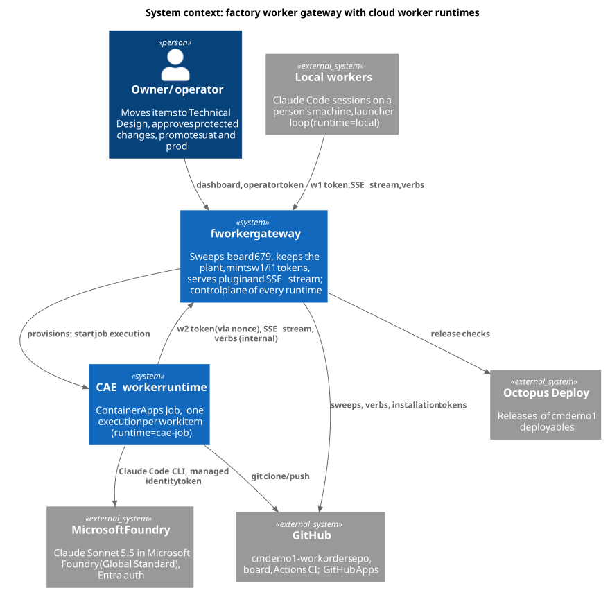
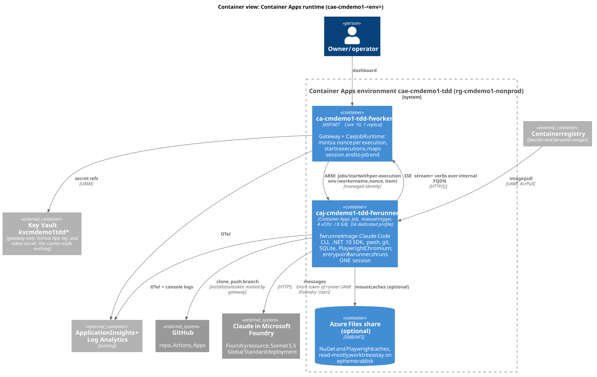

# Cloud worker runtimes: Container Apps jobs with Codex on Azure OpenAI

Status: design only, 2026-10-15. Nothing here is built or deployed. Asked for by the owner: "a container app that runs as a sidecar app with
fworker so that worker agents can be provisioned and run in the cae", and "another runtime so that it can run the agent in its container in
ai foundry". Builds on `plant-manager.md` (workers, tokens, host limits), `docs/launcher.md` (one item per session) and
`worker-messaging.md` (the stream).

Revised 2026-10-15 with the owner's decisions: the Foundry hosted-agent runtime is abandoned (no `foundry` runtime kind); the Container
Apps runtime uses Claude Sonnet 5.5 deployed in Microsoft Foundry, billed through Azure, with Entra auth by the runner's managed identity
(section 3); the runtime adapter stays, with the kinds `local` and `cae-job`.

Revised again 2026-10-15 after the owner's Azure session:
- **Claude via Foundry is blocked**: the Azure Marketplace refused the subscription for the Claude offer, and the owner chose to leave Claude
  off for now. Section 3.1 to 3.2 stay as the plan for when it is unblocked; the Claude job (`caj-cmdemo1-tdd-fwrunner`) is kept.
- **The active agent is Codex CLI on Azure OpenAI**: deployment `gpt-6.1-sol` (600k TPM) in the Foundry resource `aif-cmdemo1-tdd`, keyless
  (key auth is disabled on the resource), Entra tokens of the runner's managed identity, in a second job `caj-cmdemo1-tdd-fwrunner-codex`
  (section 3.4). The same fwrunner image runs both agents; `FWRUNNER_AGENT` chooses.
Revised 2026-10-16: **Claude in Foundry is out of scope by owner decision 2026-10-16** (out of scope, not merely blocked). cmdemo1-system
#195 removed the `claude-sonnet-5-5` deployment. The `caj-cmdemo1-<env>-fwrunner` (Claude) jobs remain but have no model, and
`FACTORY_RUNTIME_AGENT=codex` everywhere. Codex on `gpt-6.1-sol` is the hosted agent. The Claude agent path stays in the image, usable only
with another model source if Claude is ever re-scoped. Section 3.1 to 3.2 is kept as a record only.

- **Consumption, not D4, for now**: the jobs run on the Consumption profile at 4 vCPU / 8 GiB, with no termination-grace setting (2.5).

Diagrams (PlantUML sources and rendered SVG in `docs/design/diagrams/`):

| View | Source | Rendered |
|---|---|---|
| System context | `cwr-context.puml` | [cwr-context.svg](diagrams/cwr-context.svg) |
| Container view, Container Apps runtime | `cwr-cae-container.puml` | [cwr-cae-container.svg](diagrams/cwr-cae-container.svg) |
| One item, one job execution (sequence) | `cwr-lifecycle.puml` | [cwr-lifecycle.svg](diagrams/cwr-lifecycle.svg) |



## 0. Summary

1. **Container Apps runtime (recommended, build first).** A separate Container Apps **Job** `caj-cmdemo1-<env>-fwrunner` in the same
   environment as the gateway, manual trigger, started by the gateway through ARM with its managed identity: **one work item per execution** (an item may span several executions: one per phase and per retry).
   The execution runs one Claude Code session in auto mode with a settings file shipped in the image, and exits when the gateway sends
   `session.end`. This replaces the launcher loop: the fresh container is the fresh context. Not a literal sidecar (section 2.13).
2. **Model: Codex CLI on Azure OpenAI `gpt-6.1-sol` is the active agent** (section 3.4): Entra token of the runner's managed identity, no
   key. Claude in Microsoft Foundry (section 3.1 to 3.2) is out of scope by owner decision 2026-10-16; the Claude path in the image is
   usable only with another model source if ever re-scoped.
3. **A runtime adapter in the gateway**: `runtime` on the worker registration (`local`, `cae-job`), an `IWorkerRuntime`
   interface with provision and deprovision, capacity per runtime, and routing rules by label (section 4).

## 1. What a worker needs today, and what the local run taught

| Need | Today (local worker) | In a container |
|---|---|---|
| Claude Code CLI, auto mode | npm install on the machine; permission prompts and classifier refusals settled by a person | baked into the image at a pinned version; `--settings` file reviewed once (2.7) |
| Plugin | `curl /api/v1/plugin` from the connect prompt | same call at start of each execution (the plugin always matches the gateway version) |
| git push to cmdemo1-workorders | the machine's GitHub connection | installation token of a GitHub App, minted per item by the gateway (2.6) |
| .NET 10 SDK, pwsh 7.5.4, SQLite, Playwright browsers | `ensure-tools.ps1` downloads into the worker dir | baked into the image; `ensure-tools.ps1` finds them and downloads nothing |
| Disk, 2 to 7 GB per item worktree | a shared home disk that ran down to 1.4 GB | ephemeral disk of the execution, gone at exit (2.4) |
| Model credential | the person's Claude login | none: Entra token of the runner's managed identity for the Foundry deployment (3.2) |
| Worker token w1 and one item per session | pasted into a connect prompt by a person; launcher loop | a w2 minted by the gateway per execution, expiry bound to the execution (2.6) |
| Build slot and host limits | `Hosts.cs`: one private build per host | one host per execution: every execution is its own host, so the build slot is always free (4.3) |

Evidence of 2026-10-14 (owner's overnight log, not committed) that shapes this design:

- **Disk pressure**: free space fell to 1.4 to 2.1 GB several times; 19 GB of closed-item worktrees could not be removed because the
  classifier refused "irreversible local destruction"; root-owned scratch copies; an 8.5 GB local telemetry file (issue 305). An ephemeral
  disk per item removes this whole class.
- **Memory**: the tdd gateway itself was OOM-killed five times (1 GiB limit, working set 1.1 GB) and each restart left workers hung. Cloud
  workers add stream load: the gateway's size must be raised before cloud workers scale (section 6, step 0).
- **Classifier refusals**: `subscribe` under Monitor, `plugin-sync`, `accept`, the private build (`build.ps1` with SQLite) and worktree
  removal were each denied once by the auto-mode classifier, and two of four workers were drained for it. A reviewed settings file in the image
  settles these once for every execution.
- **Stalls and restarts**: a session that missed `item.assigned` after a gateway restart, leases lost three times during a long Functional
  Testing phase, `watchdog-relaunch-budget` parks. The job model gives each stall a hard end (the execution timeout) and a clean re-route.

## 2. Container Apps runtime



### 2.1 Provisioning model

Three options were weighed:

| Option | How | For | Against |
|---|---|---|---|
| A. **Job per item, manual trigger, started by the gateway** (recommended) | `POST .../jobs/{name}/start` with a per-execution template override (env vars); the gateway decides when | the gateway already decides who gets which item; exact one-item-per-execution; per-execution env carries the worker name; no queue to build | the gateway needs `Microsoft.App/jobs/start/action` on one job; ARM call latency (seconds) |
| B. Job per item, event-driven (KEDA on a queue) | gateway writes a message to an Azure Storage or Service Bus queue; KEDA starts an execution per message | standard pattern; ARM rights not needed by the gateway | a second source of truth (queue) beside the plant; the execution does not know its item until it reads the message; a new resource and a new secret; KEDA polling delay (30 s) |
| C. Long-lived replicas of a container app with KEDA scaling on the plant's queue depth | an app `ca-...-fwrunner` with min 0, max N; a KEDA scaler on a metric of the gateway | warm containers, faster start | a replica outlives an item: we would rebuild the launcher loop inside it and lose the fresh disk; scale-in can kill a replica mid-item (no graceful drain longer than 600 s); the queue-depth metric needs an external scaler |

Option A because the plant is already the queue: the sweep decides an item is ready, the plant picks a worker, and with the adapter the
"worker" is created at that moment. Option B is the fallback if the owner does not want the gateway's identity to hold an ARM right.

Capacity is the adapter's `maxConcurrent` (section 4.2), not a KEDA rule. Set the job's `parallelism` 1, `replicaCompletionCount` 1,
`replicaRetryLimit` 0 (retries are the gateway's decision, 2.11).

### 2.2 One item per container lifetime

The execution is the session. Its entrypoint `fwrunner.sh`:

1. downloads the plugin with the w2 token (after redeeming the nonce) (`GET /api/v1/plugin`), clones the work-orders repository shallowly;
2. writes the connect prompt from a template in the image plus the values of the execution (gateway URL, name, capacity 1, runtime `cae-job`). The prompt names the variable that holds the credential, never the credential itself, and is never written to stdout;
3. runs `claude -p` (headless print mode, no TTY) with `--settings /etc/fworker/settings.json`, the model and effort the gateway chose, and
   `FACTORY_SESSION_END_FILE=/work/session-ended`;
4. watches the end marker (the launcher's rule: marker seen, wait 5 s, TERM, KILL after 10 s) and exits 0; exits 1 when claude exits without
   the marker.

An execution holds one item for one routed span of phases (all phases when the item is routed only to `cae-job`). At a phase boundary where the router sends the next phase elsewhere, the session releases the item and runs `end-session`; the execution exits at once and does not wait out `sessionEndGraceSeconds`, and it never takes another item.

There is no loop: the next item is a new execution with a new name, a new disk and a new context. The launcher's watchdog codes keep their
meaning with the screen checks off (no screen): `stream-disconnected` stays in `fwrunner.sh`; `no-output-while-owning` becomes "no
transcript bytes" read from Claude Code's `--output-format stream-json` output, which `fwrunner.sh` reads for liveness. Only a redacted summary line per turn goes to stdout (tokens of the forms `w1.`, `w2.`, `i1.`, `ghs_`, `sk-ant-` are masked); full transcripts go only to the private blob container (2.4).

Worker names are `cae-<item>-<6 hex>`: the plant's rule "a new stream without a cursor is a new session of that name" is met trivially, and
the dashboard shows which execution holds which item. The adapter pins the item to the name (`worker:` label is not needed: the offer goes
to the name it created; section 4.4).

### 2.3 Image, size and build pipeline

`fwrunner` image, `Dockerfile.fwrunner` at the root of this repository (to be added to CODEOWNERS in the same pull request, section 7). "Runner" here is the worker container; it is unrelated to `gateway/RunnerPool.cs`, the pool of rule-script processes:

| Layer | Content | Approx. size |
|---|---|---|
| base | `mcr.microsoft.com/dotnet/sdk:10.0` (Debian) | 0.9 GB |
| pwsh | 7.5.4 tarball, as in the gateway image | 0.2 GB |
| node 22 + Claude Code | `npm i -g @anthropic-ai/claude-code@<pinned>` | 0.25 GB |
| Playwright | Chromium only, with its OS dependencies (`playwright install --with-deps chromium`) | 0.7 GB |
| tools | git, sqlite3, curl, tar, ca-certificates, `tini` | 0.1 GB |
| warm caches (optional) | NuGet packages of cmdemo1-workorders master, restored at image build | 0.8 GB |
| fworker files | `fwrunner.sh`, the settings file, the prompt template | small |

About 3 GB without the warm NuGet layer, 3.8 GB with it. Non-root user, `tini` as PID 1 so TERM reaches claude.

Pipeline: a second job in `build.yml` (code-owner path, owner approval) builds `fwrunner` only when `Dockerfile.fwrunner`, `runner/**` or the
pinned versions change, tags it `fwrunner:<claude-code version>-<build>` and pushes it in `release.yml` next to the gateway image. The
gateway's config names the runner image tag (`runtimes.caeJob.image`), so a gateway release and a runner release are promoted together by
Octopus. A weekly rebuild picks up base-image fixes. The image never contains a credential or the connect prompt.

### 2.4 Storage

| What | Where | Why |
|---|---|---|
| Worktree, build output, app logs | **ephemeral** container disk | the execution's own; removed at exit, which ends the disk problem of section 1. Size by the workload profile (2.5) |
| NuGet package cache | image layer (warm) plus ephemeral; optionally an Azure Files share mounted read-only | a read-write shared NuGet cache over SMB is slow and racy; restore against the warm layer is fast enough |
| Playwright browsers | image layer | 0.7 GB once per image, not per item |
| Transcripts, launcher log | stdout (Log Analytics) and an upload to a blob container at exit | for the operator's post-mortem; prompts and logs may hold secrets, so the container is private and has a 14-day lifecycle rule |

Azure Files for worktrees is rejected: an item's worktree is written heavily by `dotnet build` and git, and SMB latency makes both slow;
the worktree has no value after the item's PR is pushed.

### 2.5 CPU, memory and workload profile

The Consumption profile caps a replica at 4 vCPU / 8 GiB with 8 GiB of ephemeral disk (section 3.3).
`. .\build.ps1 ; Build` (compile, unit tests, migrations, integration tests) plus Playwright acceptance tests needs about 4 vCPU and 6 to
8 GiB to finish in a reasonable time; the worktree needs 2 to 7 GB.

Recommendation: a **dedicated workload profile D4** (4 vCPU, 16 GiB) added to `cae-cmdemo1-tdd`, with the job pinned to it at 4 vCPU / 8 GiB
and an ephemeral disk large enough for the worktree. The environment today has the Consumption profile only, so this is an environment
change made through the demo-environment kit (`containerapps.bicep`). If the owner prefers no dedicated profile, start on Consumption at
4 vCPU / 8 GiB and measure whether 8 GiB of disk is enough (a 7 GB worktree leaves no room) for a docs-only and a code item; move to D4 if not.

**Decided 2026-10-15: Consumption for now.** Both jobs run on the Consumption profile at 4 vCPU / 8 GiB; no D4 profile is added. The jobs
have no termination-grace setting, so the default applies and fwrunner.sh's stop and transcript upload must fit in it. The first items
measure disk and build time; D4 is revisited if a code item runs out of the 8 GiB disk or the build does not finish within the replica timeout.

### 2.6 Identity and secrets

Two user-assigned managed identities, never one shared with the gateway:

| Identity | Holds | Rights |
|---|---|---|
| `id-cmdemo1-<env>-fworker` (exists) | gateway | as today, plus `Microsoft.App/jobs/start/action` and `.../executions/read`, `.../stop/action` on the one runner job (custom role) |
| `id-cmdemo1-<env>-fwrunner` (new) | runner job | `AcrPull` on the registry; `Foundry User` on the Foundry resource (3.2); no Key Vault right |

| Secret | Store | Reaches the execution how |
|---|---|---|
| Model credential | none | the runner identity gets an Entra token for the Foundry resource at run time (3.2); no key is stored or passed |
| GitHub App key (author App) | Key Vault, held by the gateway only | **never**. The gateway mints a GitHub installation token for the item (contents write on cmdemo1-workorders only, 1 hour, repository-scoped) and hands it to the session through a new verb `git-credential` with the item's i1 token; a git credential helper in the image calls it |
| Worker token (w2) | minted by the gateway per execution | redeemed once with a nonce (below); bound to the name `cae-<item>-<rand>` and an expiry |
| Item token i1 | minted at assignment, as today | over the stream, as today |

Why not the GitHub App key in the container: the worker could then push to any repository of the installation and outlive the item. The
per-item installation token, fetched again when it nears expiry, keeps "workers never hold a GitHub credential" nearly true (they hold a
one-hour, one-repository token).

**Worker token delivery (decided here): a one-time nonce.** The start call carries only a random nonce in a per-execution env var; the execution redeems it once at `POST /api/v1/runtime/redeem` for its worker token. A nonce read from ARM afterwards is spent. A token in an env var was rejected: anyone with read on the job's executions would see it.

**Token format and revocation.** Today w1 is `w1.<name>.<hmac>`, stateless, with no expiry, bound to the name's revocation generation (`gateway/Auth.cs`), and the generations are refs in GitHub. Adapter workers get a new kind `w2.<name>.<runtime>.<expiresUnix>.<hmac>` (expiry = execution timeout plus 15 minutes), checked next to w1; existing hand-minted w1 keep working unchanged. A normal end writes no revocation ref (the name is never used again and the token expires); only a failed or stopped execution is revoked, so refs stay few. The `git-credential` verb goes into a new verb set callable by an i1 of role `owner` only (not inspector, qc or the supervisor).

**The GitHub token is repository-wide.** Contents write lets the container push to any branch, `master` included. The control is the ruleset of `master` in cmdemo1-workorders (pull request required, no direct or force push), verified before rollout step 3; the settings file's deny rule is not a control.

### 2.7 Auto mode shipped in the image

`/etc/fworker/settings.json` (read-only, root-owned) passed with `--settings`:

- `permissions.defaultMode`: auto mode, with explicit `allow` rules for exactly the commands the classifier refused on 2026-10-14:
  `pwsh <SCRIPTS>/factory.ps1 *` (subscribe, plugin-sync, accept, end-session and every verb), `dotnet build|test|run` in the worktree,
  `pwsh ./build.ps1`, `git worktree remove` under `/work`, `rm -rf /work/*`, `npx playwright test`.
- `deny` rules: reading `/etc/fworker`, `env` and `printenv`, `curl` to any host other than the gateway, github.com and the Foundry endpoint,
  `git push --force` to `master`, writes outside `/work` and `/tmp`. These rules steer the model; they are **not a security boundary**
  (`/proc/self/environ`, node, pwsh or dotnet read the same values). The boundaries are the token scopes (2.6), the master ruleset and egress (2.8).
- `env`: `DISABLE_AUTOUPDATER=1`, `CLAUDE_CODE_DISABLE_NONESSENTIAL_TRAFFIC=1`, OTel export on (2.9). The Foundry variables (3.2) are
  set on the job template, not in this file, because the resource name differs per environment.

The file is reviewed once by the owner (`runner/settings.json`, to be added to CODEOWNERS) and changes only by pull request. The container is the
sandbox: what the classifier protects on a person's machine (their home, other repositories) does not exist in it, which is why these
rules can be wider than on a laptop.

### 2.8 Network

- **Ingress**: the runner job has none. The gateway keeps its public ingress (local workers and the dashboard need it). Executions reach it
  by the environment's internal FQDN (`http://ca-cmdemo1-tdd-fworker` inside the environment, or the internal DNS name); HTTP inside
  the environment is acceptable because the environment is the trust boundary, HTTPS is preferred where the internal name has a cert.
- **Egress**: github.com, objects.githubusercontent.com and codeload, api.nuget.org, the Foundry endpoint (`<resource>.services.ai.azure.com`) and Entra ID
  (`login.microsoftonline.com`) plus the managed identity endpoint of the environment, the Playwright CDN only at image build, the npm registry only at image build. The environment has no VNet today, so egress is
  open. A restricted egress needs the environment on a VNet with a NAT gateway and Azure Firewall or NSG rules: a separate, larger
  environment change (open question 4).

### 2.9 Logs and telemetry

- stdout and stderr of `fwrunner.sh` and claude's `stream-json` go to the environment's log destination (Log Analytics `ContainerAppConsoleLogs`),
  with the execution name and the worker name on every line. The environment's `appLogsConfiguration` showed no destination in the read-only
  check; that must be set (kit change) or logs are lost when the execution ends.
- Claude Code's OpenTelemetry export (`CLAUDE_CODE_ENABLE_TELEMETRY=1`, OTLP to an OTel collector or the Azure Monitor exporter) sends token
  counts and cost per session to the existing Application Insights, tagged `fworker.worker`, `fworker.item`, `fworker.runtime=cae-job`.
- The gateway adds a span per provision and deprovision and a metric `fworker.runtime.executions{runtime,outcome}`.
- `/api/v1/status` gets `runtimes` (section 4.5).

### 2.10 Cost per item and scale to zero

Assumptions: an item takes 30 to 90 minutes of execution time; the model cost dominates.

| Part | Estimate per item |
|---|---|
| Compute, D4 dedicated profile | a D4 node is billed while it exists; with min 0 nodes and one item at a time, about 0.4 to 1.2 node-hours. Several items share a node |
| Compute, Consumption at 4 vCPU / 8 GiB | about 4 vCPU x 1 h x the per-vCPU-second rate plus 8 GiB x 1 h: well under a dollar per item at list price |
| Model tokens | the dominant cost: Sonnet 5.5 on Foundry, from a few dollars (docs-only) to tens of dollars (a code item), on the Azure bill (3.2) |
| Storage, logs | cents |

Exact rates were not looked up for this document: the estimate is the shape, the first tdd week measures it (`fworker.runtime.executions` and
Claude Code's cost metric). Jobs scale to zero by nature: with no item routed there is no execution and no compute bill; the D4 profile's
`minimumCount` is 0.

### 2.11 Failure handling

| Event | Detection | Action |
|---|---|---|
| Item ends normally | `end-session` writes the marker; or the gateway's `session.end` after `sessionEndGraceSeconds` | execution exits 0; adapter sees `Succeeded`, the w2 expires |
| Session stuck (`session.restart` codes `spent-idle`, `repeated-question`) | gateway tick | in a job, restart means **end**: the client writes the marker and reason, execution exits 0; the item, if still owned, is taken back by the sweep and re-routed to a new execution |
| No stream or no transcript output | `fwrunner.sh` watchdog | exit 1; same take-back |
| Execution never offered an item (offer lapsed, item went to another worker) | adapter: no owned item `runtimes.caeJob.ackSeconds` after `worker.registered` | adapter deprovisions (stops the execution); `session.end` would never come because the session is not spent |
| Execution timeout | `replicaTimeout` (set 4 h; the maximum is not documented, configurable per item class: 1 h docs-only) | Container Apps kills the replica; adapter sees `Failed`; take-back and re-route |
| Image pull or start failure | execution `Failed` within minutes and no `worker.registered` | adapter marks the runtime unhealthy after 2 in a row, routes to `local` until an operator resets it |
| Gateway restart | executions keep running and reconnect their stream (cursor) | the plant snapshot restores owners; the adapter re-reads its executions from ARM at start (`jobs/{name}/executions`), so it does not start a second one |
| Retry | the gateway's decision, not `replicaRetryLimit` | at most 2 executions per item per phase; the third failure parks the item with a new park code `runtime-failed`, using the existing park mechanism and the operator's `unpark` |

The existing `watchdog-relaunch-budget` counts executions the same way it counts relaunches, so the two do not burn the budget twice.

### 2.12 SQL Server-dependent tests

The build of cmdemo1-workorders already falls back to SQLite where no SQL Server is present (`CLAUDE.md` of that repository: "LocalDB on
Windows, Docker container on Linux, SQLite fallback"). In a Container Apps execution there is no Docker daemon, so the fallback is
SQLite; that is what the local Linux workers do today.

| Choice | For | Against |
|---|---|---|
| **SQLite in the container** (recommended) | no shared state, nothing to secure, parallel items never collide | SQL Server-specific behaviour is not tested by the worker; CI on the pull request runs against SQL Server and catches it |
| Shared Azure SQL test database | real engine | parallel items collide on migrations; a credential in every execution; cost |
| SQL Server as a second container in the execution (sidecar of the job) | real engine, isolated | about 2 GiB more memory per execution; the image is 1.5 GB; start time |

### 2.13 Where "sidecar" fits

Container Apps supports several containers in one app (sidecars sharing the replica's network and lifecycle). A literal sidecar on the
fworker app is **not recommended**:

- it shares the gateway's replica: one replica (`maxReplicas` 1, and only one gateway may sweep), so at most one worker, and a worker's
  build would compete for the gateway's memory, which already OOM-killed the gateway five times on 2026-10-14;
- a gateway release would restart the worker mid-item, and a worker crash or OOM could restart the gateway;
- one item per container lifetime is impossible: the sidecar lives as long as the gateway replica.

"Sidecar" is therefore read as "a companion resource in the same environment, owned and driven by fworker": the Container Apps Job
`caj-cmdemo1-<env>-fwrunner`, deployed by the same Octopus project as the gateway (a second step), sharing the environment, the registry,
the Key Vault and Application Insights, and reachable only through the gateway. The one literal sidecar that may later earn its place is an
OTel collector next to the gateway.

## 3. Model: Codex on Azure OpenAI (Claude in Foundry out of scope)

**Out of scope by owner decision 2026-10-16.** Claude in Microsoft Foundry (the Azure Marketplace Anthropic deployment) is not pursued;
cmdemo1-system #195 removed the `claude-sonnet-5-5` deployment. Sections 3.1 and 3.2 are kept as a record of the former plan, not as a
plan. The hosted agent is Codex CLI on `gpt-6.1-sol` (3.4). The Claude agent path in the fwrunner image stays and is usable only with
another model source if Claude is ever re-scoped; the Claude jobs `caj-cmdemo1-<env>-fwrunner` remain without a model, and
`FACTORY_RUNTIME_AGENT=codex` everywhere.

### 3.1 Facts (re-checked 2026-10-15; record only)

| Fact | Source |
|---|---|
| Claude Code on Foundry is switched on by `CLAUDE_CODE_USE_FOUNDRY=1` plus `ANTHROPIC_FOUNDRY_RESOURCE` (the resource name alone, never a URL; `ANTHROPIC_FOUNDRY_BASE_URL` is the alternative). With `ANTHROPIC_FOUNDRY_API_KEY` and `ANTHROPIC_FOUNDRY_AUTH_TOKEN` unset, Claude Code uses the Azure SDK default credential chain (Microsoft Entra ID) | code.claude.com/docs/en/microsoft-foundry, "Configure Azure credentials" and "Configure Claude Code" (read 2026-10-15) |
| Pin every alias: without `ANTHROPIC_DEFAULT_OPUS_MODEL` the `opus` alias resolves to an older built-in default, and Foundry has no startup model check, so requests fail when that default is not deployed. The values are deployment names. Background tasks use the primary model unless `ANTHROPIC_DEFAULT_HAIKU_MODEL` names a deployed Haiku | same page, "Pin model versions" |
| Roles: "The `Azure AI User` and `Cognitive Services User` default roles include all required permissions"; minimal custom role: data action `Microsoft.CognitiveServices/accounts/providers/*`. The Claude-in-Foundry page names the first role **Foundry User** (formerly Azure AI User) | same page, "Azure RBAC configuration"; platform.claude.com/docs/en/build-with-claude/claude-in-microsoft-foundry, "Prerequisites" (read 2026-10-15) |
| Claude Sonnet 5.5 supports only Global Standard deployments; the deployment name defaults to the model ID (`claude-sonnet-5-5`) and cannot be changed after creation | Claude-in-Foundry page, "Hosting options" and "Creating Foundry deployments" |
| Billing through the Azure Marketplace in Claude Consumption Units, metered hourly, invoiced monthly on the Azure bill; the first Claude deployment accepts the Marketplace terms | Claude-in-Foundry page, "Billing" and step 4 of "Creating Foundry deployments" |
| Hosted on Azure lacks code execution, Agent Skills (API tool), Files API and the newer web search/fetch tool versions; Claude Code detects this and adapts | Claude-in-Foundry page, "Additional features not supported when hosted on Azure" |
| Foundry returns no `anthropic-ratelimit-*` headers; a 429 means the deployment's rate limit, raised through the Azure portal or support | Claude-in-Foundry page, "Rate limiting" |

### 3.2 Model deployment (former plan; deployment removed by cmdemo1-system #195)

- **Resource and deployment**: a Foundry resource `aif-cmdemo1-<env>` in `rg-cmdemo1-nonprod` (tdd and uat), its own in prod; one deployment
  `claude-sonnet-5-5` (model Claude Sonnet 5.5, Global Standard, Hosted on Azure, a fixed model version, not "auto-update"). Created by the
  demo-environment kit (rollout step 2). Entra ID authentication on. Our own hardening, not from the cited docs: local (key) authentication disabled on the resource
  (`disableLocalAuth`), so no key exists to leak. The deployment name must equal the model ID: Claude Code reads it to give Sonnet 5 and
  later the 1M context window.
- **Role**: the runner identity `id-cmdemo1-<env>-fwrunner` gets **Foundry User** (formerly Azure AI User) scoped to that Foundry resource
  only. Cognitive Services User also works; a custom role with the data action `Microsoft.CognitiveServices/accounts/providers/*` is the
  narrowest choice if the owner prefers it.
- **Env vars on the job template** (no secret among them):

  | Variable | Value |
  |---|---|
  | `CLAUDE_CODE_USE_FOUNDRY` | `1` |
  | `ANTHROPIC_FOUNDRY_RESOURCE` | `aif-cmdemo1-<env>` (name only) |
  | `ANTHROPIC_DEFAULT_SONNET_MODEL` | `claude-sonnet-5-5` |
  | `ANTHROPIC_DEFAULT_OPUS_MODEL` | `claude-sonnet-5-5`: no Opus is deployed, so the `opus` alias and the `opus` profiles of `plugin/scripts/models.default.json` run on Sonnet 5.5 instead of failing; reviews meant for Opus get Sonnet quality and cost |
  | `ANTHROPIC_DEFAULT_HAIKU_MODEL` | `claude-sonnet-5-5`: no Haiku is deployed (also Claude Code's Foundry default for background tasks) |
  | `AZURE_CLIENT_ID` | client ID of `id-cmdemo1-<env>-fwrunner`, so the default credential chain picks the user-assigned identity (Azure Identity convention for `DefaultAzureCredential`, not on the Claude pages) |

  `ANTHROPIC_FOUNDRY_API_KEY`, `ANTHROPIC_FOUNDRY_AUTH_TOKEN` and `ANTHROPIC_API_KEY` are never set; `fwrunner.sh` unsets them before
  starting claude.
- **Quota**: about 3 concurrent sessions (rollout step 4, `maxConcurrent` 3). A session sends large cached contexts with bursts of tool
  turns; plan on roughly 150 to 250 k input tokens per minute per busy session, so request **at least 600 k TPM** (and the matching
  requests per minute) on the deployment, then size from the first week's 429 count and Claude Code's token metrics (2.9). The estimate is
  ours, not a published figure. Claude Code retries 429 with backoff; repeated 429 shows up as stalls, not failures.
- **Billing**: usage appears on the Azure bill of the subscription as an Azure Marketplace charge (Claude Consumption Units), next to the
  Container Apps compute; no Anthropic account or invoice is involved. Cost Management budgets on the resource group cover it.

### 3.3 Container Apps limits

| Fact | Source (date) |
|---|---|
| Consumption: up to 4 vCPU / 8 GiB per replica in a workload-profiles environment (2 vCPU / 4 GiB in a consumption-only environment); images up to 8 GB | learn.microsoft.com/en-us/azure/container-apps/containers (updated 2026-03-25) |
| Ephemeral storage: 8 GiB per replica above 1 vCPU | learn.microsoft.com/en-us/azure/container-apps/storage-mounts (ms.date 2026-08-21) |
| Dedicated D4 to D32: 4 to 32 vCPU, 16 to 128 GiB | learn.microsoft.com/en-us/azure/container-apps/workload-profiles-overview (updated 2026-06-26) |
| Jobs: manual, schedule or event (KEDA) triggers; `replicaTimeout`, `replicaRetryLimit`; platform maintenance can interrupt long jobs; last 100 executions kept; no ingress. The maximum `replicaTimeout` is not documented | learn.microsoft.com/en-us/azure/container-apps/jobs (ms.date 2026-09-16) |
| Dynamic sessions with custom containers: Hyper-V sandbox, pre-warmed pool, egress off by default; considered and not chosen because a session is driven by HTTP calls into the container, not a batch run | learn.microsoft.com/en-us/azure/container-apps/sessions-custom-container (updated 2026-05-10) |

### 3.4 Hosted agent: Codex CLI on Azure OpenAI (decided 2026-10-15)

| Fact | Source |
|---|---|
| Codex providers are set in `config.toml` under `[model_providers.<id>]` with `base_url` and `wire_api = "responses"`; for Azure the v1 API needs `/openai/v1` in `base_url` and no `api-version` | learn.microsoft.com/azure/foundry/openai/how-to/codex (ms.date 2026-09-03); learn.chatgpt.com/docs/config-file/config-reference (read 2026-10-15) |
| Microsoft's page says "Entra ID support is currently not available for Codex": there is no built-in Azure credential chain | same Microsoft page, "Troubleshooting" |
| Command-backed auth: `[model_providers.<id>.auth]` with `command`, `args`, `timeout_ms` (default 5000), `refresh_interval_ms` (default 300000) and `cwd`; the command gets no stdin and prints the token; Codex refreshes it proactively and after an auth failure; it cannot be combined with `env_key` | learn.chatgpt.com/docs/config-file/config-advanced, "Command-backed authentication" (read 2026-10-15) |
| Codex CLI 0.155.1 is validated with `gpt-6-sol` on Azure OpenAI; `gpt-6.1-sol`, the deployment used here, is not on Microsoft's validated list | Microsoft page, "Validated versions" |

The design: Codex 0.155.1 in the fwrunner image; `FWRUNNER_AGENT=codex` makes fwrunner.sh write `$CODEX_HOME/config.toml` with the
provider `azure` (`base_url = https://aif-cmdemo1-tdd.openai.azure.com/openai/v1`, `model = gpt-6.1-sol`) and an auth command,
`fwrunner-entra-token`, that fetches a token for `https://cognitiveservices.azure.com` of the runner identity (`AZURE_CLIENT_ID`) from the
Container Apps identity endpoint. The bearer token is therefore an Entra token, refreshed by Codex every 10 minutes (`refresh_interval_ms = 600000` in the config) and after a 401; no key
exists anywhere. Both jobs use the same runner identity (client id `45fb5295-…`); it needs **Cognitive Services OpenAI User** on `aif-cmdemo1-tdd` (Foundry User also covers it). The
agent's own commands do not inherit the identity endpoint variables (`shell_environment_policy`).

How the factory reaches Codex: the plugin's skills are Claude Code skills. fwrunner.sh generates `$CODEX_HOME/AGENTS.md` from a Codex
preamble, the connect prompt, an index of the plugin's skills and the full owner-session skill; Codex reads the other skills as files.
Limits: Codex in this setup has no subagents, so the analyst, implementer, reviewer and inspector roles run inline in the one session, one
after the other (multi-agent tools exist in Codex but are not validated on `gpt-6.1-sol` and are left off); `model-for --role subagent` is
not used; there are no Claude hooks, Monitor or ToolSearch. The command policy is Codex execpolicy rules that forbid the prefixes of the
Claude settings' deny list (env, printenv, force pushes, pushes to master or main, wget, nc, ssh, scp, sudo); a deny in the middle of a
command is not expressible as a prefix, so branch protection and the per-item token stay the controls, as for Claude. Approval is `never`
and the sandbox mode is `danger-full-access` by default (the container is the boundary, as for Claude's auto mode); `workspace-write` can
be chosen once the Codex Linux sandbox is shown to work in a Consumption replica. The worker still registers with type `claude-cloud`.

The adapter chooses the job by `runtimes.caeJob.agent` and `runtimes.caeJob.jobs.<agent>` and passes `FWRUNNER_AGENT`; the gateway
identity holds the job-operator role on both jobs. Only the active agent's job is listed and stopped, so a switch of agent is a redeploy
after the other job's executions have ended. Where sections 1, 2.6, 2.7, 5 and 6 speak of Claude Code, Foundry User and the
`claude-sonnet-5-5` deployment or the D4 profile, they describe the Claude path, which is out of scope (owner decision 2026-10-16); for the active path read
Codex, Cognitive Services OpenAI User on `aif-cmdemo1-tdd`, the `gpt-6.1-sol` deployment and the Consumption profile.

## 4. The runtime adapter in the gateway

### 4.1 Registration

The stream registration (`GET /api/v1/workers/{name}/stream`, `subscribe --own`) gets `runtime=` (`local` default, `cae-job`).
The gateway trusts the claim only when it matches the credential: a w2 minted by an adapter carries the runtime, and a hand-minted w1
is always `local`. `/status` and the dashboard show the runtime per worker.

### 4.2 Interface

```csharp
interface IWorkerRuntime
{
    string Kind { get; }                                   // "cae-job"
    int MaxConcurrent { get; }                              // runtimes.<kind>.maxConcurrent
    Task<ProvisionResult> Provision(ProvisionRequest r, CancellationToken ct);   // item, phase, model profile, worker name, nonce
    Task Deprovision(string workerName, string reason, CancellationToken ct);    // stop execution; idempotent
    Task<IReadOnlyList<RuntimeInstance>> List(CancellationToken ct);             // for restart recovery and status
}
```

`local` is not an adapter: local sessions connect by themselves as today. `CaeJobRuntime` calls ARM with the gateway's managed identity
(`Azure.ResourceManager.AppContainers` or plain REST with `Azure.Identity`; a new NuGet package for this repository, owner approval).
The interface stays so that another runtime can be added later without touching the plant.

### 4.3 Capacity

- `runtimes.caeJob.maxConcurrent` (start at 1 in tdd, 3 in rollout step 4; the model quota of 3.2 is sized for 3).
- An adapter-created worker registers with capacity 1 and its own host name, so `Hosts.cs` gives it its own build slot.
- A daily budget per runtime (`runtimes.<kind>.maxExecutionsPerDay`) stops a loop of failed executions from spending money.

### 4.4 Routing

The plant routes an item that is ready and has no live owner:

1. a `worker:<name>` pin wins, as today (local workers stay pinnable);
2. a label `runtime:local` or `runtime:cae-job` on the item forces the runtime;
3. otherwise `runtimes.routing`, an ordered list of rules in `config/instance.json`, for example
   `[{ "phase": "*", "runtime": "cae-job" }, { "runtime": "local" }]`;
4. a connected local worker with free capacity takes precedence when `runtimes.preferConnected` is true (default true in tdd, so the
   existing workers are not starved during rollout);
5. a runtime at `maxConcurrent`, over budget or unhealthy is skipped.

The adapter provisions only after the plant has chosen the runtime; the offer goes to the name the adapter created, with a
longer acknowledgement window for adapter workers to cover the container start (`runtimes.caeJob.ackSeconds`, 300). New work: today
`timing.assignAckSeconds` (120) is one global value, so the plant needs a per-worker window.

### 4.5 Status

`GET /api/v1/status` gains `runtimes: { "cae-job": { "maxConcurrent", "running", "today", "healthy", "last": [...] }, ... }` and per worker
`runtime` and `execution`. The operator session reads it; it cannot provision (no new verb for it).

## 5. Security boundary and guard rails

- **Trust boundary**: the container is untrusted code execution (it runs the model's commands and the repository's build). It holds a w2
  bound to one name and an expiry, an i1 for one item, a one-hour GitHub token for one repository, and the managed identity's ability to call the one Foundry deployment. It holds no Octopus
  key, no GitHub App key, no token secret, no operator token.
- **Model credential**: none stored. The runner identity's Entra token (about 1 hour) can call only the Foundry resource it has Foundry User
  on; local authentication is off on the resource. A leaked token spends model quota until it expires; the deployment's TPM quota and a
  Cost Management budget cap that.
- **Egress**: with open egress, a prompt injection can send any token in the container anywhere. Open egress is accepted for tdd only;
  restricted egress (2.8) is a precondition for uat and prod.
- **Secrets in telemetry**: no credential in argv, the prompt text or stdout (2.2); Log Analytics retention 30 days and read access for the
  operator only; full transcripts only in the private blob container.
- **Revocation**: ending an execution revokes its name's generation; `POST /workers/{name}/revoke` stops the execution too.
- **Prompt injection**: unchanged rules: item and PR text are data. The container limits the blast radius to one repository and one item.
- **Kill switch**: `runtimes.<kind>.enabled` false (config override) or the operator's drain of the runtime stops new executions; running
  ones finish.
- **Operator session**: may read runtime status and drain a runtime; may not change runtime config.
- **Config**: every `runtimes.*` setting defaults to disabled (`maxConcurrent` 0) in `config/instance.json`, which is not a code-owner
  path; a runtime is switched on and sized only in `config/deploy.overrides.json`, which is. A Tier 1 check asserts the source defaults are off.
- **Per environment (5.1)**: one image runs in tdd, uat and prod. The block in the image is selected by `FACTORY_ENVIRONMENT`
  (`runtimes.environments.<name>`), and its caeJob, which names tdd's jobs and identity, applies only in tdd, in `local` (`run-owner-gateway.sh`) or with no environment
  named (tests). In any other environment caeJob starts off: enabled, sizes, jobs, identity and gateway URL are cleared. The
  environment's gateway app switches it on with these variables, set by the system's `environmentSettings`; no uat or prod id lives in
  this repository:

  | Variable | Sets |
  |---|---|
  | `FACTORY_RUNTIME_ENABLED` | `true` switches caeJob on, only with a job of the active agent and an identity client id; `false` switches it off |
  | `FACTORY_RUNTIME_AGENT` | `claude` or `codex` |
  | `FACTORY_RUNTIME_JOB_CLAUDE` | resource id of the claude job |
  | `FACTORY_RUNTIME_JOB_CODEX` | resource id of the codex job |
  | `FACTORY_RUNTIME_IDENTITY_CLIENT_ID` | client id of the gateway's managed identity (`managedIdentityClientId`) |
  | `FACTORY_RUNTIME_GATEWAY_URL` | the gateway address the execution uses (`FWORKER_GATEWAY_URL`) |
  | `FACTORY_RUNTIME_MAX_CONCURRENT` | `maxConcurrent` |
  | `FACTORY_RUNTIME_MAX_PER_DAY` | `maxExecutionsPerDay` |

  The job variable must match the agent: with `FACTORY_RUNTIME_AGENT` unset outside tdd the agent is `claude`, so a codex job alone leaves
  caeJob off. A variable also overrides the baked value in tdd. A value that does not parse is ignored with a line on stderr. Routing rules are not set by variables, so an
  environment switched on this way runs only items labelled `runtime:cae-job`.
- **Adapter workers always run one item per session**: the gateway ignores `FACTORY_ONE_ITEM_PER_SESSION=0` for them.
- **Gateway replicas**: with runtimes on, the gateway keeps `minReplicas` 1 (today 0), or executions lose their stream when it scales to zero.

## 6. Rollout

| Step | Where | Exit criterion |
|---|---|---|
| 0 | tdd gateway | the read-only check of 2026-10-15 shows 1 vCPU / 2 GiB already (the OOMs were at 1 GiB); verify no OOM for a week with the local workers |
| 1 | this repository | adapter interface, `runtime` claim, routing with only `local` configured; Tier 1 suites with a fake ARM |
| 2 | kit and system repo | runner identity, job, D4 profile, log destination, Foundry resource with the `gpt-6.1-sol` deployment, its quota and the Cognitive Services OpenAI User assignment (3.4), in tdd only |
| 3 | tdd | precondition: master ruleset of cmdemo1-workorders verified (2.6), gateway `minReplicas` 1. Then `runtimes.caeJob.enabled` with `maxConcurrent` 1, items labelled `runtime:cae-job` only; 10 docs-only items, then 5 code items |
| 4 | tdd | routing rule on by default (open question 6 decides `preferConnected`), `maxConcurrent` 3; a week of measurements (time, cost, failures) against the local workers |
| 5 | uat | manual Octopus promotion of gateway and runner; the uat environment gets its own job and identities, and a Cognitive Services OpenAI User assignment |
| 6 | prod | only after `activate-prod.sh`; prod is inert today |

## 7. Code-owner paths touched

From `.github/CODEOWNERS`, these changes need the owner's review: `/Dockerfile` pattern does not cover a new `Dockerfile.fwrunner`, so add it
to CODEOWNERS in the same pull request; `/.github/` (the build and release jobs for the runner image); `/gateway/Auth.cs` (the w2 kind, the nonce
redemption, the new verb set with `git-credential`); `/config/deploy.overrides.json` (runtimes on in the deployed image);
`/plugin/skills/factory-operator/` (if the operator session is told about runtimes). New paths that should be added to CODEOWNERS:
`/Dockerfile.fwrunner`, `/runner/` (entrypoint, settings file, prompt template), `/gateway/Runtimes/` (the adapter holds the ARM right). `gateway/Program.cs` and the connect prompt are mixed files: the connect prompt's hash is pinned by the operator suite, so the
runner uses its own prompt template rather than changing it.

## 8. Open questions for the owner

1. ARM right for the gateway (option A) or a queue between gateway and job (option B)?
2. ~~Dedicated D4 workload profile, or Consumption?~~ **Decided 2026-10-15**: Consumption at 4 vCPU / 8 GiB for now (2.5).
3. ~~Model credential for the runner~~ **Decided 2026-10-15**: Claude Sonnet 5.5 in Microsoft Foundry (Global Standard), Entra auth by the runner's managed identity, no key, billed on the Azure bill (section 3). **Blocked the same day** by the Azure Marketplace, then **out of scope by owner decision 2026-10-16** (cmdemo1-system #195 removed the deployment). **Codex CLI on Azure OpenAI `gpt-6.1-sol`** with Entra is the hosted agent (3.4); the Claude path in the image needs another model source if ever re-scoped.
4. Restricted egress (VNet, NAT, firewall) now, or open egress for tdd?
5. Pushes through a per-item installation token of the author App (new `git-credential` verb), or a separate "runner" GitHub App?
6. Should cloud executions be preferred over connected local workers once proven, or stay opt-in by label?
7. Budget: a daily cap of executions and of model spend per runtime in tdd.
